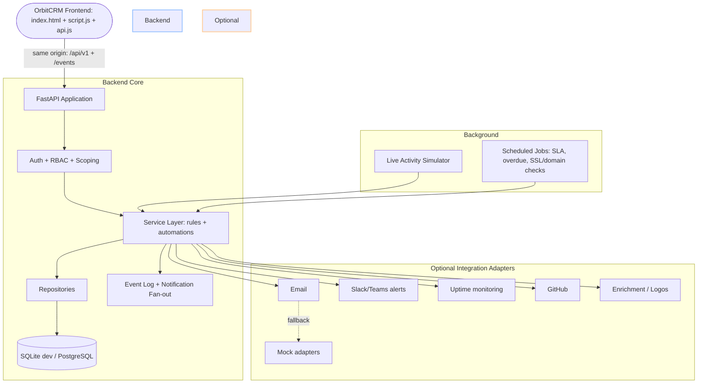
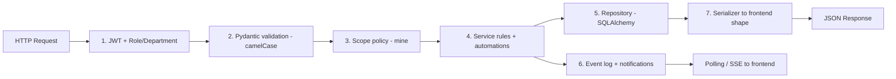
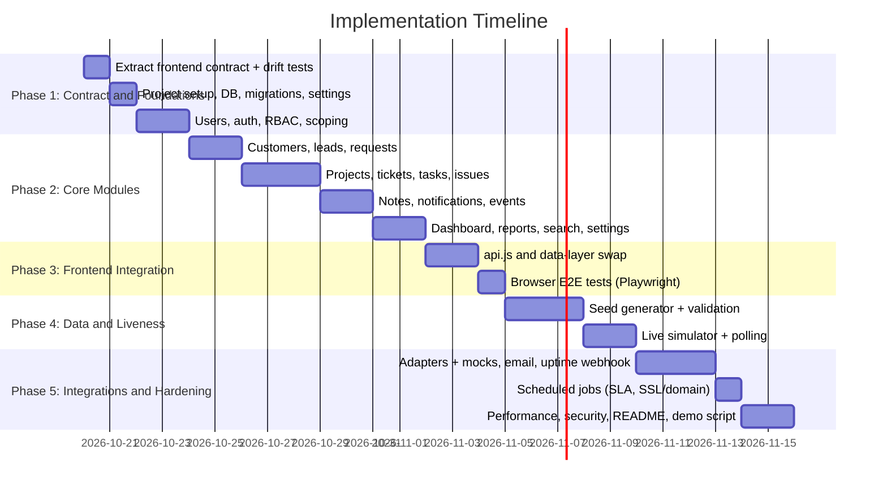

# Implementation Plan - OrbitCRM Backend (Frontend-Aligned, Live-Looking IT Services CRM)

This document **supersedes the earlier generic CRM plan**. It is written against the *actual* OrbitCRM frontend (`index.html`, `styles.css`, `script.js`). The frontend is a vanilla-JS single-page app for an **IT services company** (Website Development, IT Support & Maintenance) with three user types: **Admin**, **Employee** (Sales / Development / IT Support) and **Customer**. Today it keeps everything in `localStorage`. The goal is to replace that with a real backend so that **frontend and backend behave as one product**: same entities, same field names, same statuses, same ID formats, same permission rules, same wording.

> ### Read this first (instructions to the coding agent, Antigravity)
> 1. **The frontend is the source of truth for the contract.** Where this document and `script.js` disagree on a field name, status, ID format, date format, or message text, **`script.js` wins**, unless this document explicitly lists the difference under "Intentional corrections" (Section 15.3).
> 2. **Do not redesign the UI.** Do not touch `styles.css` except to add small classes if a listed optional enhancement needs one. Do not migrate to React or any framework. Keep file names.
> 3. **Contract first.** Phase 1 produces `contract/frontend_contract.json` (extracted from `script.js`) and contract tests. Every later phase must keep them green.
> 4. **One source of truth for enums and messages** on the backend (`app/domain/`). Tests must prove they equal the arrays/strings hard-coded in `script.js` (drift test).
> 5. After every phase: run the tests, boot the app with one command, log in with each demo account, and click every sidebar item. Never leave the app broken.
> 6. The app must run fully with **zero API keys** (mock adapters). Real integrations are optional add-ons.

---

## 1. Project Objective and Scope

### Objective
Build a backend that makes OrbitCRM feel like a real IT services company (**Orbit IT Solutions**) is using it daily: believable customers, leads moving through a pipeline, projects with progress, support tickets with SLAs, tasks, notes and notifications, plus new activity that appears while the demo runs. The frontend must not "feel" like it has a different backend: every number on every dashboard, every table column and every toast must come from, and agree with, the API.

### Scope
- **In-Scope**: REST API under `/api/v1`; JWT auth with roles and departments; server-side data scoping identical to the frontend's `mine()` logic (with fixes, Section 15.3); all 12+ modules the UI already exposes; automations the UI implies (service request -> lead, escalation -> notification, etc.); realistic seed data; live activity simulator; polling/SSE for live updates; optional third-party integrations behind adapters; tests including frontend contract and browser end-to-end tests.
- **Out-of-Scope**: UI redesign, mobile apps, multi-tenant SaaS, real billing, sending real email/SMS/WhatsApp to real people.

---

## 2. Frontend Audit (Ground Truth Extracted from the Uploaded Files)

### 2.1 Roles, portals and sidebar modules
| Login type | Portal label | Sidebar modules |
|---|---|---|
| Admin | Admin Portal | Dashboard, Customers, Leads, Pipeline, Projects, Tickets, Tasks, Employees, Departments, Reports, Notifications, Settings, Profile, Logout |
| Employee - Sales | Sales Portal | Dashboard, My Leads, Pipeline, Customers, My Tasks, Notes, Notifications, Profile, Logout |
| Employee - Development | Development Portal | Dashboard, My Projects, My Tasks, Issues, Customers, Notes, Notifications, Profile, Logout |
| Employee - IT Support | IT Support Portal | Dashboard, Tickets, Customers, My Tasks, Escalations, Notes, Notifications, Profile, Logout |
| Customer | Customer Portal | Dashboard, Request Service, My Requests, My Projects, Support Tickets, Notifications, Profile, Logout |

### 2.2 Demo accounts that MUST keep working (the login screen displays them)
| Login ID | Password | Name | Role / Dept | Email | Phone |
|---|---|---|---|---|---|
| `admin.admin` | `admin123` | Aarav Sharma | Admin / Admin | admin@orbitcrm.test | 9876543210 |
| `sales.emp` | `sales123` | Priya Nair | Employee / Sales | priya@orbitcrm.test | 9876543211 |
| `developer.emp` | `dev123` | Vikram Rao | Employee / Development | vikram@orbitcrm.test | 9876543212 |
| `support.emp` | `support123` | Ananya Das | Employee / IT Support | ananya@orbitcrm.test | 9876543213 |
| `customer.user` | `customer123` | Rahul Mehta (Acme Technologies, customerId 1) | Customer | rahul@acme.example | 9876543214 |

Registered customers log in with **their email as the Login ID**.

### 2.3 Entity shapes the UI renders (exact camelCase keys, as in the frontend seed)

```jsonc
// Customer            id is an integer
{ "id": 1, "name": "Rahul Mehta", "company": "Acme Technologies", "email": "rahul@acme.example",
  "phone": "9876543214", "status": "Active", "date": "12 Sep 2026" }

// Lead                id like "L-101"
{ "id": "L-101", "name": "Rahul Mehta", "company": "Acme Technologies", "service": "Website Development",
  "source": "Website", "status": "Requirement Discussion", "assigned": "Priya Nair",
  "followup": "30 Sep 2026", "customerId": 1, "notes": ["Customer needs a business website and contact form."] }

// Project             id like "P-101"; progress is an integer 0-100
{ "id": "P-101", "name": "Acme Business Website", "customer": "Acme Technologies", "customerId": 1,
  "service": "Website Development", "assigned": "Vikram Rao", "status": "Development", "priority": "High",
  "deadline": "15 Oct 2026", "progress": 60, "updates": ["Homepage and contact form are in development."] }

// Ticket              id like "T-102"
{ "id": "T-102", "customer": "Acme Technologies", "customerId": 1, "subject": "Contact form not working",
  "priority": "High", "assigned": "Ananya Das", "status": "In Progress", "created": "25 Sep 2026",
  "due": "30 Sep 2026", "latest": "Support is investigating the form validation.", "description": "...", "notes": [] }

// Task                id is an integer; "related" holds a lead/project/ticket ID
{ "id": 1, "title": "Follow up on Acme requirements", "department": "Sales", "assigned": "Priya Nair",
  "related": "L-101", "priority": "High", "due": "30 Sep 2026", "status": "Pending" }

// Service request     id like "R-101"
{ "id": "R-101", "customerId": 1, "service": "Website & Application Development",
  "description": "Business website with contact form", "contact": "Email", "date": "21 Sep 2026",
  "status": "Requirement Discussion", "assigned": "Priya Nair" }

// Issue               id like "I-1" (reported by developers)
{ "id": "I-1", "title": "...", "related": "P-101", "priority": "Medium", "description": "...",
  "assigned": "Vikram Rao", "status": "New", "department": "Development", "due": "04 Oct 2026" }

// Notification (currently a plain string in the UI; the API returns an object, see 11.6)
// Employee (Employees page): name, loginId, department, email, status
// Department (Departments page): name, description, employees (count), active ("N active")
// Settings: companyName "Orbit IT Solutions", notificationPreference "All CRM updates" | "Important only"
```

### 2.4 Fixed enumerations (hard-coded in `script.js`; backend must serve identical lists)
- **Lead status / Pipeline stages (in this order)**: `New, Contacted, Qualified, Requirement Discussion, Quotation, Negotiation, Won, Lost`
- **Project status**: `Not Started, Planning, Development, Testing, Deployment, Completed, Blocked, Waiting for Customer`
- **Ticket status**: `New, Assigned, In Progress, Escalated, Resolved, Customer Confirmation, Closed`
- **Task status**: `Pending, In Progress, Completed`
- **Issue status**: `New, In Review, Resolved, Closed` (UI only ever creates `New`)
- **Request status**: mirrors the lead status (mapping in 12.3); initial value `Submitted`
- **Priority**: `Low, Medium, High`
- **Services**: `Website Development`, `IT Support & Maintenance`, `Website & Application Development`
- **Preferred contact method**: `Email, Phone`
- **Lead sources seen**: `Website, Referral, LinkedIn, Other`
- **Departments**: `Sales, Development, IT Support` (and `Admin` for the admin user)
- **Status badge colours are decided by a regex in the frontend (`statusClass`)**: green = `Completed|Resolved|Closed|Won|Active|Approved`; red = `High|Blocked|Lost`; blue = `New|Planning|Contacted|Submitted|Testing`; purple = `Development|Escalated|Quotation`; everything else amber. **Do not invent new status words** unless you also accept the amber colour.

### 2.5 Formats the UI prints verbatim
- **Dates**: `DD Mon YYYY` in English, e.g. `30 Sep 2026` (fields: `date`, `followup`, `deadline`, `created`, `due`). Compute in `Asia/Kolkata`. Never rely on the server locale for month names.
- **IDs**: Leads `L-<n>`, Projects `P-<n>`, Tickets `T-<n>`, Requests `R-<n>`, Issues `I-<n>`; Customers and Tasks are plain integers. IDs are **assigned by the backend only** (the frontend must stop generating them).
- **Names are join keys in the UI**: the frontend scopes by `x.assigned === user.name` and `x.customer === user.company`. Therefore **employee full names and customer company names must be unique**.
- **Detail modal prints every top-level non-object key** of a record (except `notes`, `updates`, `customerId`) as a label/value row. Consequence: **any extra top-level key you add to a record will appear in the UI**. See Golden Rule 3.

### 2.6 Behaviours implied by the frontend (the backend must implement them for real)
1. Login with Login ID + password; error text `Invalid Login ID or Password.`
2. Customer self-registration creates a Customer record (status `Active`) and a login (email = login ID); duplicate email error `An account with this email already exists.`; success text `Registration successful. You can now sign in.`
3. A customer's **Request Service** submit creates a Request (`Submitted`) **and** a Lead (source `Website`, status `New`, assigned to a sales employee, follow-up in 2 days) and the notification `Your service request has been received.`
4. Pipeline cards are leads grouped by status; changing a lead's status moves it.
5. Updating a ticket to `Escalated` produces the notification `<ticketId> has been escalated to Development.`; to `Resolved`: `<ticketId> has been resolved; awaiting customer confirmation.`
6. Projects have `progress` and status updates by Development/Admin; Customers see their own but cannot edit.
7. Notes form (`Related record` + `Note`): saves a note; notification `New note added by <name>.`
8. Notifications: list, "Clear all".
9. Profile update: name, phone, company (customers only), optional new password; email is read-only.
10. Settings (admin): company name and notification preference.
11. Reports: status counts for leads, projects, tickets, and task counts per department.
12. Global search (Enter in the top bar) across customers, leads, projects, tickets.
13. Dashboard: role-specific stat cards, a 6-month "Workflow Overview" bar chart, and "Needs Attention" (high-priority or escalated tickets).
14. Employee accounts are never deleted (`Employee accounts stay in history when inactive`).

---

## 3. Golden Rules for "No Frontend/Backend Conflict"

1. **Same keys, same casing.** API JSON is camelCase and uses exactly the keys in 2.3. Use a Pydantic `alias_generator=to_camel` and `populate_by_name=True`.
2. **Same values.** Enums come from one module; strings like `Website & Application Development` are byte-identical (note the `&`).
3. **Extras go in `meta`.** Anything the UI does not already know (e.g., contact email on a lead, deal value in INR, enrichment data, timestamps, `pinned` flag, structured note entries) goes in a nested `meta` object. The detail modal skips nested objects (`typeof v === 'object'`), so the UI stays unchanged while the data exists for future screens.
4. **Display strings for display fields.** Date fields are returned as `DD Mon YYYY` strings. The ISO value goes in `meta` (e.g., `meta.dueAt`).
5. **Server-side scoping.** The client no longer decides what a user may see. Every list endpoint applies the same rules as `mine()` (plus the fixes in 15.3). A customer must never receive another customer's data, even by guessing an ID.
6. **Backend generates IDs, dates, defaults, assignments.** The frontend sends only what the forms contain.
7. **Same words in messages.** Error and notification texts in 11.7 must match the strings above, so toasts read naturally.
8. **No plaintext passwords in the frontend.** The `accounts` array (with passwords) is deleted from `script.js`. Demo credentials come from `GET /auth/demo-accounts` (disabled in production).
9. **Drift is a test failure.** Contract and enum tests run in CI. Changing `script.js` or the backend without the other fails the build.
10. **Single deployment origin.** The backend serves the frontend files, so there is no CORS or "different server" feel.

---

## 4. Explicit System Boundary



---

## 5. Final Architecture



Layering rule: `routers -> services -> repositories -> models`. Serializers (`app/serializers/`) are the **only** place that converts DB rows to frontend shapes (date formatting, `assigned` names, `meta` packing). No router builds dicts by hand.

---

## 6. Recommended Tech Stack

- **Language**: Python 3.11+.
- **Framework**: `FastAPI` + `uvicorn`; static mount serves `frontend/`.
- **Validation/Settings**: `pydantic` v2, `pydantic-settings`.
- **Database**: `SQLite` by default (zero setup, single file, easy reset); `PostgreSQL 16` via `DATABASE_URL` for production-like runs. Code must work on both.
- **ORM/Migrations**: `SQLAlchemy 2.x` + `Alembic`.
- **Auth**: `pyjwt`, `argon2-cffi` (or `bcrypt`).
- **Background**: `APScheduler` (in-process) for the simulator and scheduled jobs. Redis is optional, not required.
- **HTTP client**: `httpx` + `tenacity`.
- **Seed data**: `Faker` (`en_IN`), `numpy`.
- **Testing**: `pytest`, `httpx.AsyncClient`, `respx`, **Playwright** (browser E2E against the real frontend).
- **Quality**: `ruff`, `mypy`.
- **Packaging**: `Dockerfile` + `docker-compose.yml`; one command `make dev` (or `python -m app.cli dev`).

---

## 7. Repository/Project Folder Structure

```
orbitcrm/
├── frontend/
│   ├── index.html                 # add <script src="api.js"> before script.js
│   ├── styles.css                 # unchanged
│   ├── script.js                  # UI code kept; data layer swapped to api.js (Section 15)
│   └── api.js                     # NEW: fetch wrapper, token handling, state refresh, polling
│
├── backend/
│   ├── app/
│   │   ├── main.py                # app factory, static mount, error handlers, routers
│   │   ├── settings.py
│   │   ├── db.py
│   │   ├── security.py            # JWT, hashing, current_user dependency
│   │   ├── domain/
│   │   │   ├── enums.py           # statuses, priorities, services, departments (single source)
│   │   │   ├── messages.py        # exact toast / notification strings
│   │   │   ├── scoping.py         # mine(): visibility rules per role/department
│   │   │   └── rules.py           # SLA offsets, defaults, request<->lead status mapping
│   │   ├── models/                # users, customers, leads, requests, projects, tickets, tasks,
│   │   │                          # issues, notes, notifications, events, status_history, settings, id_sequences
│   │   ├── schemas/               # camelCase request/response models
│   │   ├── serializers/           # DB -> frontend shape (dates, names, meta)
│   │   ├── repositories/
│   │   ├── services/              # auth, leads, requests, projects, tickets, tasks, issues, notes,
│   │   │                          # notifications, dashboard, reports, search, employees, settings
│   │   ├── routers/
│   │   ├── simulator/             # live_simulator.py, event_catalog.py, business_hours.py
│   │   ├── jobs/                  # sla_check.py, overdue_check.py, domain_ssl_check.py
│   │   └── integrations/          # base.py + email/ chat/ uptime/ github/ enrichment/ (each with mock.py)
│   ├── seed/
│   │   ├── generate.py            # python -m seed.generate
│   │   ├── profile.yaml           # volumes, distributions, persona
│   │   ├── reference/             # name banks, ticket subjects, project templates, note templates
│   │   ├── builders/              # employees, customers, leads, requests, projects, tickets, tasks, notes, notifications
│   │   └── validate.py            # realism + integrity checks
│   ├── migrations/
│   └── tests/
│       ├── contract/              # frontend contract + enum drift tests (MOST IMPORTANT)
│       ├── unit/  api/  seed/  simulator/  integration/
│       └── e2e/                   # Playwright against the running app
│
├── contract/
│   └── frontend_contract.json     # extracted from script.js in Phase 1, checked into git
├── docs/ API.md  DEMO.md
├── .env.example  docker-compose.yml  Makefile  README.md
```

---

## 8. Data Models and Entities

Internal tables use integer primary keys plus a human `public_id` where the UI shows a prefixed ID. IDs are produced by an `id_sequences` table (`prefix`, `next_value`) inside the creating transaction so they are never reused.

```python
class User:        id, login_id (unique), full_name (unique), email (unique), phone, role  # Admin | Employee | Customer
                   department  # Sales | Development | IT Support | Admin | None
                   password_hash, customer_id (FK, customers only), is_active, last_login_at
class Customer:    id (int, shown as id), name, company (unique, case-insensitive), email, phone, status, joined_on,
                   industry, city, portal_enabled, meta (JSON: gstin, website, enrichment)
class Lead:        public_id "L-n", name, company, customer_id (nullable), service, source, status, assigned_user_id,
                   followup_on, created_at, closed_at, meta (JSON: email, phone, valueInr, pinned, requestId)
class Request:     public_id "R-n", customer_id, lead_id, service, description, contact, details, status, assigned_user_id, created_on
class Project:     public_id "P-n", name, customer_id, lead_id (nullable), service, assigned_user_id, status, priority,
                   deadline_on, progress (0-100), started_on, completed_on, meta (JSON: valueInr, repoUrl, pinned)
class Ticket:      public_id "T-n", customer_id, subject, description, priority, assigned_user_id, status, created_at,
                   due_at, resolved_at, closed_at, latest (text), channel, sla_breached, meta (JSON: pinned, source, csat)
class Task:        id (int), title, department, assigned_user_id, related (public_id string), priority, due_on, status,
                   completed_at, created_at
class Issue:       public_id "I-n", title, related (project id), priority, description, assigned_user_id, status, department, due_on
class Note:        id, entity_type, entity_public_id (nullable), author_id, text, created_at       # backs notes[]/updates[]
class Notification:id, user_id, message, importance ("normal"|"high"), kind, entity_public_id, created_at, read_at
class Event:       id (autoincrement cursor), type, entity_type, entity_public_id, audience (JSON list of user ids), at
class StatusHistory: id, entity_type, entity_public_id, from_status, to_status, changed_by, changed_at
class Setting:     key, value  # companyName, notificationPreference
class AuditLog:    id, actor_id, action, entity_type, entity_public_id, before, after, at
```

### Serializer mapping rules
- `assigned` = assigned user's `full_name`; `customer` = customer's `company`; `customerId` = `customer_id` (omitted when null, exactly like the frontend seed for L-102).
- `notes` (leads, tickets) and `updates` (projects) = list of note **text strings**, oldest first; structured entries go in `meta.noteEntries` (`author`, `at`, `text`).
- Dates: `fmt_date(dt, tz="Asia/Kolkata")` -> `DD Mon YYYY` using a fixed month-abbreviation table.
- Required indexes: `(assigned_user_id, status)` on leads/projects/tickets/tasks, `(customer_id)` everywhere, unique `public_id`, `(user_id, read_at)` on notifications, case-insensitive unique index on `customers.company` and `users.full_name`.

---

## 9. Configuration Parameters

`backend/config/default_config.yaml`:

```yaml
system:
  env: "demo"                       # dev | demo | prod   (demo exposes /auth/demo-accounts and /demo/*)
  timezone: "Asia/Kolkata"
  seed: 42
  database_url: "sqlite:///./orbitcrm.db"

company:
  name: "Orbit IT Solutions"
  notification_preference: "All CRM updates"      # or "Important only"

defaults:                           # replace values the frontend used to hard-code
  lead_followup_days_manual: 4      # frontend: 29 Sep -> 03 Oct
  lead_followup_days_request: 2     # frontend: 29 Sep -> 01 Oct
  task_due_days: 3                  # frontend: 29 Sep -> 02 Oct
  project_deadline_days: 16         # frontend: 29 Sep -> 15 Oct
  issue_due_days: 5
  project_default_service: "Website Development"
  project_default_priority: "Medium"
  lead_default_source: "Other"
  assignment_strategy: "least_loaded"   # round-robin by open-item count within the department

sla:                                # ticket due date offsets in days from creation
  High: 2
  Medium: 4
  Low: 7

automation:
  auto_create_project_on_won: true  # lead -> Won creates a Project in "Not Started"
  create_task_on_escalation: true
  mirror_request_status_from_lead: true

simulator:
  enabled: true
  business_hours_ist: "10:00-19:00"
  working_days: [Mon, Tue, Wed, Thu, Fri]         # light Saturday activity
  events_per_minute_business_hours: 3
  events_per_minute_off_hours: 0.2
  burst_mode_events_per_minute: 12                # for live demos
  pinned_records_untouched: true                  # anchor demo records are never mutated by the simulator

integrations:
  email_send_mode: "sandbox"        # sandbox | allowlist | off  (NEVER live in demo)
  timeout_seconds: 8
  max_retries: 3
  cache_ttl_seconds: {logo: 604800, company: 86400, domain: 86400}

auth:
  access_token_hours: 8
  login_rate_limit_per_minute: 10
  password_min_length: 6
```

`.env.example` (every key optional): `DATABASE_URL`, `JWT_SECRET`, `DEMO_PASSWORD`, `RESEND_API_KEY`, `BREVO_API_KEY`, `MAILTRAP_API_TOKEN`, `SLACK_WEBHOOK_URL`, `TEAMS_WORKFLOW_WEBHOOK_URL`, `UPTIMEROBOT_API_KEY`, `UPTIME_WEBHOOK_SECRET`, `GITHUB_TOKEN`, `LOGO_DEV_PUBLIC_KEY`, `BRAND_DEV_API_KEY`, `HUNTER_API_KEY`, `ANTHROPIC_API_KEY`.

---

## 10. Authentication and Permissions

### 10.1 Auth flow
- `POST /auth/login {id, password}` -> `{ token, user }` where `user` has the **same shape the frontend's `user` variable uses** (minus password): `{ id (login id), name, role, department?, email, phone, company?, customerId? }`.
- JWT in the `Authorization: Bearer` header; the frontend keeps it in `sessionStorage` (not `localStorage`). 401 -> frontend returns to the login screen.
- Passwords hashed (argon2/bcrypt). Login rate-limited. Inactive users cannot sign in.

### 10.2 Permission matrix (derived from what each portal can do in the UI)
| Capability | Admin | Sales | Development | IT Support | Customer |
|---|---|---|---|---|---|
| Read customers | all | customers of own leads | customers of own projects | customers of own tickets | own record only |
| Read/create/update leads | all | own (assigned) leads; may create | no | no | no |
| Read pipeline | all | own leads | no | no | no |
| Read/update projects (status, progress) | all | none | own (assigned) | none | read own |
| Create projects | yes | no | no | no | no |
| Read/update tickets (status, latest) | all | none | read escalated tickets of own projects' customers | own (assigned) | read own |
| Create tickets | yes | no | no | yes | yes (own company only) |
| Tasks | all | own + Sales dept | own + Development dept | own + IT Support dept | none |
| Create tasks | yes | yes | yes | yes | no |
| Issues | all | no | create/read own | no | no |
| Requests | all | own (assigned) | no | no | own; create |
| Notes | yes | yes | yes | yes | no |
| Employees / Departments / Settings / Reports | yes | no | no | no | no |
| Notifications | own | own | own | own | own |

Every endpoint enforces this on the server. Forbidden -> `403` with the standard error envelope. Reading someone else's record by ID -> `404` (do not leak existence).

### 10.3 Scoping policy (`domain/scoping.py`)
Port `mine(items, key='assigned')` to SQL filters:
- Admin: everything.
- Customer: `customer_id == user.customer_id`.
- Employee: `assigned_user_id == user.id` **OR** (for entities with a department, i.e. tasks) `department == user.department`.

---

## 11. API Specification

Base path `/api/v1`. JSON camelCase. Lists return a plain array (the UI iterates arrays directly). Default cap 500 rows, newest first, optional `?limit=&offset=`.

### 11.1 Endpoints
```
AUTH      POST /auth/login | /auth/register | /auth/forgot-password | /auth/logout
          GET  /auth/demo-accounts                       # demo/dev env only
ME        GET /me      PATCH /me                         # {name, phone, company?, password?}
BOOTSTRAP GET /bootstrap                                  # one call: everything the signed-in user's UI needs (11.2)
LISTS     GET /customers | /leads | /projects | /tickets | /tasks | /requests | /issues | /notifications
          GET /employees | /departments                   # admin
DETAIL    GET /customers/{id} | /leads/{id} | /projects/{id} | /tickets/{id} | /tasks/{id} | /requests/{id} | /issues/{id}
CREATE    POST /leads | /projects | /tickets | /tasks | /issues | /requests | /notes | /customers
UPDATE    PATCH /leads/{id}      # status, followup?, assigned? (admin)
          PATCH /projects/{id}   # status, progress, assigned? (admin)
          PATCH /tickets/{id}    # status, latest, assigned? (admin)
          PATCH /tasks/{id}      # status (and title/due/priority)
          PATCH /issues/{id}     # status
NOTIFS    POST /notifications/clear     POST /notifications/{id}/read
DASH      GET /dashboard
REPORTS   GET /reports/summary           # admin
SEARCH    GET /search?q=
SETTINGS  GET /settings      PUT /settings  # admin
META      GET /meta/options              # enums, services, departments, sources (for dropdown drift-proofing)
LIVE      GET /events?after=<cursor>     # polling (cheap, preferred)    GET /events/stream  # SSE (optional)
WEBHOOKS  POST /webhooks/uptime | /webhooks/calendly      # secret/signature verified
SYSTEM    GET /health | /ready | /version
DEMO      POST /demo/reset | /demo/simulator/{start|stop|burst}    # admin + env != prod only
```

### 11.2 `GET /bootstrap` (minimizes frontend changes)
Returns exactly the collections the old `state` object held, already scoped for the caller, plus extras:
```json
{
  "customers": [], "leads": [], "projects": [], "tickets": [], "tasks": [],
  "requests": [], "issues": [], "notifications": [],
  "employees": [], "departments": [], "settings": {},
  "options": { "leadStatuses": [], "projectStatuses": [], "ticketStatuses": [], "taskStatuses": [],
               "priorities": [], "services": [], "contactMethods": [], "departments": [] },
  "dashboard": { "stats": [], "workflow": [], "attention": [] },
  "unreadCount": 0, "cursor": 1842
}
```
`employees` and `departments` are empty arrays for non-admins. After any mutation the frontend re-fetches `/bootstrap` (or the affected list) and calls `render()`, so the old synchronous rendering code keeps working.

### 11.3 Create payloads (exactly the fields each frontend form sends)
- `POST /leads`: `{name, company, service, status}`. Backend sets id, `source` (default `Other`), `assigned`, `followup`, links `customerId` if `company` matches an existing customer.
- `POST /projects`: `{name, customer, status, progress}`. Backend resolves `customer` (company name, case-insensitive, trimmed) to a customer; sets service, assigned (least-loaded developer), priority, deadline.
- `POST /tickets`: `{customer, subject, description, priority}`. Customer-role callers: `customer` is ignored and replaced by their own company. Backend sets status `New`, created, due (SLA), assigned (least-loaded IT Support employee), `latest = "Ticket received."`.
- `POST /tasks`: `{title, related, priority}`. Backend sets department (creator's, default `Sales` for Admin), assigned (creator), due, status `Pending`.
- `POST /issues`: `{title, related, priority, description}` -> status `New`, assigned = reporter, department `Development`.
- `POST /requests`: `{service, description, contact, details?}` (customer only) -> triggers automation 12.1.
- `POST /notes`: `{related?, note}` -> 12.5.
- `POST /auth/register`: `{name, company, email, phone, password, confirm}`.

### 11.4 Update payloads
- Lead: `{status}`; Project: `{status, progress}`; Ticket: `{status, latest}`; Task: `{status}`; Issue: `{status}`.
- Accept **any** value from the status enumeration (the UI offers every status in a dropdown, so valid choices must never produce an error). Reject unknown values with `422`.
- Every change writes `StatusHistory`, `AuditLog`, an `Event`, and any notifications from section 12.

### 11.5 Dashboard payload
```json
{ "stats": [ {"key": "TOTAL_CUSTOMERS", "label": "TOTAL CUSTOMERS", "value": 142}, ... ],
  "workflow": [ {"label": "May", "value": 31}, ... 6 items ... ],
  "attention": [ {"id": "T-102", "subject": "...", "customer": "...", "status": "...", "priority": "High"} ] }
```
The frontend keeps its own icon/colour table, keyed by `key`. Stat definitions (these fix the frontend's miscounts, Section 15.3):

| Role | Key -> definition |
|---|---|
| Admin | `TOTAL_CUSTOMERS` all customers; `NEW_LEADS` leads with status `New`; `ACTIVE_PROJECTS` status != `Completed`; `OPEN_TICKETS` status not in (`Closed`,`Resolved`); `PENDING_TASKS` status != `Completed` |
| Sales | `MY_LEADS` assigned to me; `FOLLOW_UPS_DUE` my leads not `Won`/`Lost` with follow-up <= today + 3 days; `ACTIVE_OPPORTUNITIES` my leads not `Won`/`Lost`; `PENDING_TASKS` visible tasks != `Completed` |
| Development | `ACTIVE_PROJECTS` assigned, != `Completed`; `TASKS_DUE_SOON` visible tasks != `Completed` due within 3 days; `OPEN_ISSUES` my issues not `Resolved`/`Closed`; `CUSTOMERS` distinct customers of my projects |
| IT Support | `OPEN_TICKETS` assigned, not `Closed`/`Resolved`; `HIGH_PRIORITY` of those with `High`; `PENDING_TASKS` visible tasks != `Completed`; `ESCALATIONS` assigned with `Escalated` |
| Customer | `ACTIVE_REQUESTS` my requests not in (`Approved`,`Closed`); `ACTIVE_PROJECTS` != `Completed`; `OPEN_TICKETS`; `COMPLETED_SERVICES` projects `Completed` |

- `workflow`: records **created** in each of the last 6 calendar months (including the current month) among the leads, projects, tickets and tasks visible to the caller. Labels are short month names (`Apr`...). The frontend computes bar height as `value / max * 100`.
- `attention`: up to 3 open tickets within the caller's scope that are `High` priority or `Escalated`, ordered Escalated first, then nearest due date. Scope for Sales/Development = tickets of customers they work with; never unscoped.

### 11.6 Notification object
```json
{ "id": 912, "message": "High-priority ticket T-102 needs attention.", "when": "Today", "kind": "CRM update", "read": false }
```
`when` is `Today`, `Yesterday`, or `N days ago`. The UI line `Today · CRM update` becomes `${when} · ${kind}`.

### 11.7 Error envelope and message catalog
All errors: `{ "error": { "code": "VALIDATION_ERROR", "message": "human readable" } }` with the right HTTP status. The frontend shows `error.message` in its toast. Required exact messages:

| Situation | Message |
|---|---|
| Bad login | `Invalid Login ID or Password.` |
| Duplicate registration | `An account with this email already exists.` |
| Password mismatch (also checked server-side) | `Passwords do not match.` |
| Registration success | `Registration successful. You can now sign in.` |
| Weak password | `Password must be at least 6 characters.` |
| Unknown customer on ticket/project | `No customer named "<X>" was found. Check the company name.` |
| Forbidden | `You do not have access to this record.` |
| Record created (generic) | `Record created` |
| Status updated | `Status updated` |
| Profile updated | `Profile updated successfully` |
| Request submitted | `Service request submitted successfully` |
| Note saved | `Note saved` |
| Issue reported | `Issue reported` |
| Settings saved | `Settings saved` |

---

## 12. Business Rules and Automations (Service Layer)

All automations run in the **same transaction** as the triggering change, then emit `Event` rows and notifications. The simulator uses these same services, so simulated activity and human activity are indistinguishable.

### 12.1 Service request submitted (customer)
1. Create `Request` (`Submitted`, `contact`, `details`).
2. Create `Lead` (`source` `Website`, `status` `New`, `service` from the request, `customerId` = customer, `followup` = today + 2 days) assigned to the least-loaded Sales employee; link `lead.meta.requestId`.
3. Notify: customer `Your service request has been received.`; assigned sales employee `New lead <L-id> (<company>) has been assigned to you.`; admin `New service request <R-id> from <company>.` (normal importance).

### 12.2 Lead status change
- Move along any status the UI allows; record `StatusHistory`; set `closed_at` on `Won`/`Lost`.
- Mirror to the linked request (12.3) when `mirror_request_status_from_lead` is true.
- On `Won` (and `auto_create_project_on_won`): create a Project in `Not Started` (service from the lead, assigned to least-loaded developer, priority `Medium`, deadline by service type in 13.4) and notify admin + developer: `Lead <L-id> was won; project <P-id> has been created.`
- On `Lost`: no project; optionally store `meta.lostReason` (price, competitor, no response, timing).

### 12.3 Request status mapping (what the customer sees)
`New -> Submitted`, `Won -> Approved`, `Lost -> Closed`, every other lead status maps to the same word (`Contacted`, `Qualified`, `Requirement Discussion`, `Quotation`, `Negotiation`).

### 12.4 Project rules
- `progress` clamped to 0-100. `Completed` forces 100 and sets `completed_on`. `Not Started` forces 0. Other statuses keep the given progress.
- Notify the customer and admin: `<project name> moved to <status>.`; `Blocked` also notifies admin with high importance; `Completed` also creates a follow-up task for Sales: `Collect feedback from <company>`.

### 12.5 Ticket rules
- **Create**: `status New`, `created` today, `due` = today + SLA(priority), assignee = least-loaded IT Support employee, notify assignee (`New ticket <T-id> assigned to you.`), and for `High` also admin: `High-priority ticket <T-id> needs attention.` (high importance).
- **Status -> Assigned/In Progress**: set `latest` from the request if given, else a stock sentence per status (list in `domain/messages.py`).
- **Status -> Escalated**: notify admin + all active Development employees `<T-id> has been escalated to Development.` (high importance); when `create_task_on_escalation`, create a Development task `Investigate escalated ticket <T-id>` (priority `High`, due +1 day) assigned to the least-loaded developer.
- **Status -> Resolved**: set `resolved_at`; notify the customer and admin `<T-id> has been resolved; awaiting customer confirmation.`
- **Status -> Customer Confirmation / Closed**: set `closed_at` on `Closed`; stop SLA timers.
- **SLA**: a scheduled job flags tickets overdue (`sla_breached = true`) and, once per ticket, notifies assignee + admin `Ticket <T-id> is past its due date.`

### 12.6 Notes
`POST /notes {related?, note}`:
- `related` starting `L-` appends to that lead's `notes`; `T-` to the ticket's `notes`; `P-` to the project's `updates`; empty or unknown -> stored as a general note (no record).
- Validate that the caller can see the related record.
- Notify the record's assignee and admin: `New note added by <name>.` (never the author).

### 12.7 Customer registration and profile
- Registration creates `Customer` (`status Active`, joined today) and the Customer-role `User` (login = email, `portal_enabled`).
- `PATCH /me`: name and phone for everyone; `company` only for Customers (also updates the customer record; company stays unique); password optional (>= 6 chars). Email is never editable.

### 12.8 Task rules
Tasks are never auto-deleted. `Completed` sets `completed_at`. Overdue = `due < today` and not `Completed` (used by dashboards and the simulator).

### 12.9 Notification preference
`Important only` suppresses notifications with `importance = "normal"` for everyone (high importance still delivered). The setting is stored in `Setting` and applied inside the notification service, so the Settings page really does something.

### 12.10 Employees
Admin-only create / deactivate. Deactivating sets `is_active = false`, keeps history, reassigns **open** leads/tickets/projects/tasks to the least-loaded active colleague in the same department, and notifies admin.

---

## 13. Seed Data Specification (Make Orbit IT Solutions Look Real)

Do **not** fill tables with uniform random rows. Generate from statistical models with a fixed seed (`seed=42`), relative to the **run date** so data never looks stale. `python -m seed.generate` must finish in under 60 seconds and end by running `seed/validate.py`.

### 13.1 Company persona
**Orbit IT Solutions**: a mid-size Indian IT services firm (default HQ Pune; configurable) that builds websites and business applications and runs managed IT support and maintenance contracts (AMC) for small and mid-size businesses across India, with a few international clients.

### 13.2 People
| Group | Count | Names |
|---|---|---|
| Admin | 1 | Aarav Sharma (`admin.admin`) |
| Sales | 4 | Priya Nair (`sales.emp`), Rohan Kulkarni, Neha Joshi, Sandeep Iyer |
| Development | 5 | Vikram Rao (`developer.emp`), Aditi Verma, Karan Malhotra, Sneha Pillai, Arjun Reddy |
| IT Support | 4 | Ananya Das (`support.emp`), Imran Sheikh, Pooja Deshmukh, Rakesh Gupta |

Extra employees get Login IDs like `sales.rohan`, `dev.aditi`, `support.imran`, emails `@orbitcrm.test`, and the configurable `DEMO_PASSWORD` (hashed). Only the five original demo accounts are listed on the login screen. Give employees a hidden **workload/skill multiplier** (e.g., Priya converts ~1.3x, one developer is slower) so reports look natural.

### 13.3 Volumes (configurable in `seed/profile.yaml`)
| Entity | Count | Notes |
|---|---|---|
| Customers | 140 | 2 anchors + 138 generated; ~45 have portal logins (login = email, `DEMO_PASSWORD`); ~118 `Active`, rest `Inactive` |
| Leads | ~260 | spread over the last 12 months; 3 anchors |
| Requests | ~70 | only for portal customers; each linked to a `Website`-source lead |
| Projects | ~70 | ~58 from won leads + ~12 repeat/AMC contracts; 2 anchors |
| Tickets | ~320 | 12 months; mostly logged by support staff on behalf of customers, ~25% raised by customers in the portal |
| Tasks | ~450 | mix of Pending / In Progress / Completed |
| Issues | ~40 | developer-reported, mostly `Resolved`/`Closed`, a few `New` |
| Notes | ~700 | lead notes, ticket notes, project updates |
| Notifications | ~25 per active user | mostly read, a few unread |

### 13.4 Statistical realism rules
- **Customers**: Indian SMEs across industries (retail, clinics, logistics, coaching/education, manufacturing, real estate, hospitality, D2C brands, CA/law firms, NGOs); ~10% international. Company names are **plausible fictional names, unique** (e.g., "Sahyadri Traders", "BlueLotus Clinic", "Kaveri Logistics Pvt Ltd"). Contact names are synthetic (`Faker en_IN`, curated Indian first/last name banks). Emails use reserved `*.example` domains. Phones follow the frontend convention (`98765xxxxx`, fictional).
- **Services mix (leads)**: Website Development 45%, IT Support & Maintenance 35%, Website & Application Development 20%.
- **Lead sources**: Website 30%, Referral 24%, LinkedIn 20%, Google Ads 10%, Cold Outreach 8%, Other 8%.
- **Lead status distribution (current)**: New 10%, Contacted 14%, Qualified 12%, Requirement Discussion 12%, Quotation 10%, Negotiation 6%, Won 22%, Lost 14%. Conversion funnel overall win rate ~22-28% of closed leads. Older leads are almost always `Won`/`Lost`; only the last ~60 days contain open pipeline.
- **Lead value (in `meta.valueInr`)**: websites Rs 40,000-3,00,000; website + app Rs 2,00,000-15,00,000; AMC Rs 25,000-2,00,000 per year (lognormal; few large outliers). Used for future reports; not shown in current UI.
- **Sales cycle**: IT support 7-25 days; website 15-45 days; app 40-110 days.
- **Projects**: durations by service: website 3-8 weeks; website + app 8-20 weeks; IT support/AMC = 12-month term (project name like `<Company> AMC - IT Support 2026`, `progress` = percentage of the term elapsed). **Progress must agree with status**: Not Started 0; Planning 5-20; Development 25-75; Testing 75-90; Deployment 90-98; Completed 100; Blocked/Waiting for Customer keep a mid value (20-80). Status mix: Completed 45%, Development 18%, Waiting for Customer 8%, Testing 8%, Planning 7%, Deployment 5%, Not Started 5%, Blocked 4%. About 10-15% of active projects are past deadline.
- **Tickets**: status mix for 12 months: Closed 55%, Resolved 8%, Customer Confirmation 4%, In Progress 14%, Assigned 6%, New 7%, Escalated 3-4 open at any time (total open about 28-35). Priority High 18% / Medium 52% / Low 30%. Resolution time lognormal (median ~1.5 days; High faster). 8-10% of closed tickets breached SLA; ~15% of open tickets are overdue. **At every seed and at every simulator tick, at least 3 open tickets must be High or Escalated** so the "Needs Attention" panel is never empty.
- **Ticket subjects** (build a catalog of 120+, examples): Contact form not working; Unable to reset password; Website loading slowly; SSL certificate expiring soon; Business email not sending; Admin panel login shows error 500; Payment gateway callback failing; Need backup restore; Add a new page to the site; Wi-Fi dropping in the office; VPN access for a new employee; Printer not reachable on network; Domain renewal reminder; Website down after hosting migration; Product images not uploading; Mobile layout broken on checkout; Antivirus license renewal; New employee laptop setup.
- **`latest` text** is status-appropriate (`Ticket received.`, `Assigned to <name>.`, `Support is investigating <topic>.`, `Escalated to Development for a code fix.`, `Fix deployed; please confirm.`, `Closed after customer confirmation.`).
- **Tasks**: Pending 25%, In Progress 15%, Completed 60%; ~10% of non-completed tasks overdue. `department` determines the related ID type: Sales -> `L-` ids, Development -> `P-` ids, IT Support -> `T-` ids. Titles from templates with the company name: `Follow up on <Company> requirements`, `Send quotation to <Company>`, `Build <module> page`, `Verify <Company> contact form issue`, `Prepare handover document for <Company>`.
- **Project names**: `<Company> Business Website`, `<Company> E-commerce Store`, `<Company> Support Portal`, `<Company> Mobile App`, `<Company> CRM Integration`, `<Company> AMC - IT Support 2026`.
- **Notes and updates**: 0-5 per lead (call summaries, budget talk, objections), 0-4 per ticket (troubleshooting steps), 1-6 per project (progress statements). Use a template bank of 150+ varied, human-sounding lines with variables; make them consistent with the record's status.
- **Calendar patterns**: activity timestamps Mon-Fri 10:00-19:00 IST (light Saturday); dips around Diwali week, Independence Day, Republic Day; a mild upward trend over 12 months; March (fiscal year-end) and post-Diwali months slightly busier. The 6-month `workflow` series for the admin should look like a gently rising, slightly noisy bar chart.
- **Referential logic**: a project exists for a won lead only after the lead's `closed_at`; `resolved_at >= created_at`; tasks relate to records of the correct department; notifications reference real records; `assigned` always an active employee of the right department (a deactivated former employee may appear only on closed historical records).

### 13.5 Anchor records (keep the original demo story and IDs)
Reserve these exact records. Dates are offsets from the **seed run date** (the frontend's hard-coded "today" was 29 Sep 2026, so offsets reproduce its spacing). IDs are labels, not chronology: **never assume a higher ID is newer**; list endpoints sort by creation time.

| Record | Fields |
|---|---|
| Customer 1 | Rahul Mehta, Acme Technologies, rahul@acme.example, 9876543214, Active, joined -17 days |
| Customer 2 | Meera Shah, Horizon Ltd, meera@horizon.example, 9822001112, Active, joined -9 days |
| L-101 | Rahul Mehta / Acme Technologies / Website Development / Website / Requirement Discussion / Priya Nair / follow-up +1 day / customerId 1 / note "Customer needs a business website and contact form." |
| L-102 | Jordan Lee / Nova Retail / IT Support & Maintenance / Referral / Quotation / Priya Nair / follow-up +2 days / no customerId |
| L-103 | Meera Shah / Horizon Ltd / Website Development / LinkedIn / Contacted / Priya Nair / follow-up +4 days / customerId 2 |
| P-101 | Acme Business Website / Acme Technologies / Website Development / Vikram Rao / Development / High / deadline +16 days / 60% / update "Homepage and contact form are in development." |
| P-102 | Horizon Support Portal / Horizon Ltd / Website & Application Development / Vikram Rao / Testing / Medium / deadline +10 days / 82% |
| T-101 | an older, `Closed` Acme ticket (history) |
| T-102 | Acme Technologies / Contact form not working / High / Ananya Das / In Progress / created -4 days / due +1 day / latest "Support is investigating the form validation." |
| T-103 | Horizon Ltd / Unable to reset password / Medium / Ananya Das / New / created -1 day / due +3 days / latest "Ticket received." |
| Tasks 1-3 | (1) Follow up on Acme requirements, Sales, Priya Nair, L-101, High, due +1 day, Pending; (2) Build customer registration page, Development, Vikram Rao, P-101, High, due +2 days, In Progress; (3) Verify Acme contact form issue, IT Support, Ananya Das, T-102, High, due +1 day, Pending |
| R-101 | customerId 1 / Website & Application Development / "Business website with contact form" / Email / -8 days / Requirement Discussion / Priya Nair |
| Notifications | Acme side: `High-priority ticket T-102 needs attention.` and `Acme Business Website moved to Development.` |

Anchor records have `meta.pinned = true`: the simulator never changes them, so a scripted demo stays predictable. Real user actions can still change them.

### 13.6 Seed safety
- Contact emails use `.example` / `.test`; `email_send_mode` defaults to `sandbox`; SMS/WhatsApp adapters are mocks. Seeded data can never cause a message to reach a real person.
- Mark all generated rows `is_demo = true` so `/demo/reset` can wipe and rebuild safely.
- Employee passwords are never stored in plaintext or logged.

### 13.7 Seed validation (`seed/validate.py`)
Fail loudly if: duplicate company names or employee names; any `assigned` name missing from users; dates impossible (closed before created); progress inconsistent with status; open High/Escalated tickets < 3; lead win rate outside 18-30%; any enum value outside the contract lists; any customer-role user without a customer; any `.com`/real-looking email on a seeded person; the 5 demo logins not working; any anchor record missing or different from the table above.

---

## 14. Live Activity Simulator

Goal: during a demo, new things keep happening without anyone clicking.

- Runs in-process (APScheduler) when `simulator.enabled`; `/demo/simulator/{start|stop|burst}` controls it. Business-hours-aware (IST), with the rates in the config.
- Acts as a real employee/customer by calling the **same service functions** as the API (so automations, notifications, audit and events all fire).
- **Event catalog** (weights adjustable): new portal service request (creates request + lead); new support ticket from a customer; staff logs a ticket for a customer; lead status progression (probabilities follow the funnel; `Quotation` -> `Negotiation` -> `Won`/`Lost`); ticket progression (`New -> Assigned -> In Progress -> Resolved -> Customer Confirmation -> Closed`), plus rare escalations; project progress ticks (+3-10%) and status moves (`Development -> Testing -> Deployment -> Completed`); task completed / task created; developer reports an issue; a new customer registers (about 1 per day); a note added to a lead/ticket/project.
- **Guardrails**: only valid, realistic transitions; skip `meta.pinned` records; keep >= 3 open High/Escalated tickets (create one if needed); never exceed a daily cap per type; never move a closed record backwards; deterministic with `seed` + clock when run in test mode.
- Every event writes an `Event` row (`id` is the polling cursor) with an `audience` (user ids that should see it).

---

## 15. Frontend Integration Plan (Do This Carefully)

### 15.1 Strategy: minimal-diff data-layer swap
Keep all rendering functions (`dashboard()`, `tablePage()`, `pipeline()`, `openDetail()`, `openAdd()` ...). Replace only where data comes from and where it is saved.

1. **Add `frontend/api.js`** (loaded before `script.js`): `api.get/post/patch/put`, token in `sessionStorage`, 401 -> `logout()`, error -> `toast(error.message)`, `refreshState()` = `GET /bootstrap` -> assign into `state`.
2. **Delete** the `accounts` array (with passwords), the `seed` object, and the `localStorage` load/save (`orbit-crm-demo`). Initialize `state = { customers: [], leads: [], ... }`.
3. **Login**: `POST /auth/login`; on success set `user` from the response, `await refreshState()`, then `render()`. The demo box fills from `GET /auth/demo-accounts` (hide in prod).
4. **Register / Forgot password**: `POST /auth/register` and `POST /auth/forgot-password` (backend returns a generic message; in sandbox it "sends" via the mock email adapter).
5. **Make `mine()` a pass-through** (`items => items`) because the server already scopes. Fix the **Customers page** to use `state.customers` directly (instead of deriving from projects).
6. **Dashboard**: replace local counting with `state.dashboard.stats` (keep the frontend's icon/colour list, keyed by `key`), `state.dashboard.workflow` (bars and month labels) and `state.dashboard.attention`.
7. **Mutations** (each: call API, then `await refreshState()`, close modal, toast, `render()`): add lead/project/ticket/task (`openAdd` submit), status update (`openDetail` submit), request service, add issue, note form, profile form, clear notifications, settings form.
8. **Remove client-side ID/date generation** (`L-${104+...}`, `'29 Sep 2026'`, `Date.now()` ids, hard-coded assignees like `Priya Nair`).
9. **Employees, Departments, Settings, Reports** pages read from `state.employees`, `state.departments`, `state.settings`, and `GET /reports/summary` (replace the hard-coded department rows and the `accounts` filter).
10. **Notifications** render `n.message` and `${n.when} · ${n.kind}`; the red dot shows only when `unreadCount > 0`.
11. **Live updates**: poll `GET /events?after=<cursor>` every 15 s. If the response contains events for this user **and** no modal is open **and** no input/textarea is focused, call `refreshState()` + `render()` and show a toast for high-importance notifications. Never re-render while a form is being filled (the whole page re-renders and would erase typed text).
12. **Backend unreachable**: show a simple "Cannot reach the server. Retry" message using existing `.empty` / `.notice` classes.
13. **Serve the frontend from the backend** (same origin): `GET /` -> `frontend/index.html`.

### 15.2 Optional UI enhancements (allowed; reuse existing CSS classes; no redesign)
- Task status dropdown in the detail modal (today tasks cannot be updated in the UI).
- Show `notes` / `updates` lists in the detail modal (today they are hidden).
- Make the **Issues** table's `View` button work (today it passes type `Tasks`, so nothing opens): pass `Issues` and add that collection to `openDetail`.
- Replace free-text `Customer` inputs (ticket/project forms) with a `<datalist>` populated from `state.customers` to avoid "customer not found" errors.
- Admin can reassign `assigned` on leads/projects/tickets from the detail modal.
- Drive all dropdown option lists from `state.options` (so enums can never drift).

### 15.3 Intentional corrections to frontend quirks (the API deliberately differs)
| Frontend today | Backend behaviour |
|---|---|
| Notifications are one shared global list for all users | Notifications are per user, with `when`, `kind`, `read` |
| Dashboard "Needs Attention" shows all tickets to everyone (cross-customer leak) | Scoped to the caller (11.5) |
| Development "CUSTOMERS" card counts projects | Counts distinct customers |
| "PENDING TASKS" counts completed tasks too | Excludes `Completed` |
| Customer "ACTIVE REQUESTS" counts all requests | Excludes `Approved`/`Closed` |
| "FOLLOW-UPS DUE" counts every non-Won lead | Uses the follow-up date window |
| Customers page for Sales/Support is empty (derived from projects) | Customers of their own leads/tickets/projects |
| Notes form only creates a notification, note is not stored | Note is persisted on the related record |
| New lead/project/ticket get hard-coded assignees (Priya/Vikram/Ananya) | Least-loaded employee of the right department |
| New ticket always due in 5 days | SLA by priority |
| Workflow bars are fixed numbers `[35,52,42,74,61,88]` | Real monthly counts |
| Employees/Departments/Settings are hard-coded | Served from the database |

---

## 16. Third-Party API Integrations (Optional, Behind Adapters)

**Rules for every integration**
1. Implement behind an interface and a factory: real adapter if a key exists, **mock adapter otherwise**. The app must boot and demo with zero keys.
2. Always use `httpx` with timeouts, retries with backoff, a circuit breaker, and caching. Never block an API request on a third-party call: do it in a background job.
3. Keep keys in environment variables only; never log secrets.
4. **Before wiring each API, confirm its current free tier, pricing and terms in the official docs.** Free plans change often.
5. Email defaults to **sandbox** (Mailtrap or "stored, not sent"); never send to seeded people.

| # | Purpose | Suggested API | Visible in the current UI? | Notes |
|---|---|---|---|---|
| 1 | Transactional email (service request received, ticket resolved, password reset) | **Resend** (permanent free tier of about 3,000 emails/month with a 100/day cap when last checked); **Brevo** (about 300/day free, adds its branding) | Indirectly (toasts/notifications) | **Mailtrap** sandbox is the safe default for demos. SendGrid retired its permanent free plan in May 2025, so do not pick it as the free default. |
| 2 | Staff alerts for escalations and high-priority tickets | **Slack incoming webhooks**; for Microsoft Teams use a **Workflows** webhook (Microsoft has been retiring the legacy Office 365 connector webhooks; verify before building) | No (external channel) | Fire from the notification service when `importance = high`. |
| 3 | **Auto-create tickets when a customer's website goes down** | **UptimeRobot API v3** (free plan: 50 monitors at 5-minute checks; API limited to about 10 requests/minute on free) | Yes: tickets appear | Webhook `POST /webhooks/uptime` (secret-verified) creates a `High` ticket `Website down: <site>` for the matching customer; recovery webhook adds a note and moves it to `Resolved`. Fits an IT-support firm perfectly. |
| 4 | Link projects to real code activity | **GitHub REST API** (token) | Yes after enabling `updates` display (15.2) | Store `meta.repoUrl`; a daily job appends commit summaries to `updates` and nudges `progress` for Development projects. |
| 5 | Domain and SSL expiry reminders | **RDAP** (free, no key; bootstrap via `rdap.org`) and the Python `ssl` library for certificate expiry (no API) | Yes: tickets/tasks appear | Scheduled job creates `SSL certificate expiring soon` / `Domain renewal reminder` tickets or tasks 30 days before expiry for customers with `meta.website`. |
| 6 | Meetings and bookings for requirement discussions | **Calendly API/webhooks** or **Google Calendar API** | New lead appears; meetings not shown | Booking webhook creates a `Website`-source lead; `meta.meetingAt`. |
| 7 | Company logos and brand data | **Logo.dev** (the Clearbit Logo API shut down on 8 Dec 2025; Logo.dev is the recommended replacement and requires a token); **Brand.dev** | No logo slot in the UI (initial-letter avatars only) | Store in `customer.meta.enrichment` for a future avatar upgrade. |
| 8 | Email validation / light enrichment | **Hunter.io** email verifier (small free quota) | Error toast on invalid email | Optional on registration and new lead; skip in demo mode. |
| 9 | Indian customer onboarding (GSTIN verification) | Commercial GST-verification providers (for example Surepass, Sandbox); check pricing and terms | No | Backend-only; mock in demo; store in `customer.meta.gstin`. |
| 10 | SMS / WhatsApp ticket updates | **Twilio** (trial: verified numbers only), **MSG91**, **WhatsApp Business Cloud API** | No | India SMS requires DLT registration; keep mocked. |
| 11 | AI assistance (ticket summary, reply drafts, lead priority notes) | **Anthropic API** (Claude) behind an `LLMProvider` interface | Only if you add a button | Must degrade gracefully with no key. |
| 12 | Payments / invoices (future module) | **Razorpay** test mode (INR/UPI), **Stripe** test mode | No (no invoice UI yet) | Do not build for v1 unless time remains. |
| 13 | Error monitoring | **Sentry** | No | Optional. |

Adapter skeleton:
```python
class UptimeProvider(Protocol):
    async def list_monitors(self) -> list[Monitor]: ...

def get_uptime() -> UptimeProvider:
    return UptimeRobotAdapter() if settings.UPTIMEROBOT_API_KEY else MockUptime()

@resilient(timeout=8, retries=3, breaker=True)
async def create_ticket_from_alert(alert: UptimeAlert) -> Ticket: ...   # goes through TicketService.create
```

---

## 17. Step-by-Step Implementation Phases



Phase exit criteria are in Section 21.

---

## 18. Core Pseudocode

```python
# services/requests.py - the automation the UI implies (12.1)
def submit_service_request(user, payload):
    with transaction() as tx:
        customer = customers.get(user.customer_id)
        sales = assignment.least_loaded("Sales")
        req = requests.create(customer_id=customer.id, service=payload.service,
                              description=payload.description, contact=payload.contact,
                              details=payload.details, status="Submitted", assigned_user_id=sales.id)
        lead = leads.create(name=user.full_name, company=customer.company, service=payload.service,
                            source="Website", status="New", assigned_user_id=sales.id,
                            customer_id=customer.id, followup_on=today() + days(cfg.followup_request),
                            meta={"requestId": req.public_id, "email": user.email, "phone": user.phone})
        notify(user,  M.REQUEST_RECEIVED, kind="CRM update")
        notify(sales, M.new_lead_assigned(lead), importance="normal")
        notify(admins(), M.new_request(req, customer), importance="normal")
        events.emit("request.created", req, audience=[user.id, sales.id] + admin_ids())
    return serializers.request(req)

# domain/scoping.py - port of mine()
def visible(query, model, user):
    if user.role == "Admin":    return query
    if user.role == "Customer": return query.where(model.customer_id == user.customer_id)
    cond = model.assigned_user_id == user.id
    if hasattr(model, "department"):
        cond = or_(cond, model.department == user.department)
    return query.where(cond)
```

---

## 19. Tests

### 19.1 Contract and drift tests (MOST IMPORTANT; `tests/contract/`)
- `test_enums_match_frontend_script()`: parse `frontend/script.js` with regex for the status/priority/service arrays and assert equality with `domain/enums.py`.
- `test_demo_accounts_match_contract()`: the five demo logins exist with exact names, departments, emails, phones; the login works with the documented passwords.
- `test_entity_key_sets_exact()`: for lead, project, ticket, task, request, issue, customer, the API JSON top-level keys equal the contract (extras only inside `meta`).
- `test_no_extra_top_level_keys_visible_in_modal()`: every non-object top-level key is in the contract's allowed list.
- `test_date_fields_format()`: all date fields match `^\d{2} (Jan|Feb|Mar|Apr|May|Jun|Jul|Aug|Sep|Oct|Nov|Dec) \d{4}$`.
- `test_id_formats()`: `L-\d+`, `P-\d+`, `T-\d+`, `R-\d+`, `I-\d+`; customer and task ids are integers; ids are unique and never reused.
- `test_message_strings_match_catalog()`: login error, registration messages, escalation/resolved notification texts.
- `test_status_badge_words_covered()`: every status the backend can emit is handled by the frontend `statusClass` regex or intentionally amber.
- `test_dashboard_stats_match_table_counts()`: for each role, each stat equals the count derived from that role's list endpoints.

### 19.2 Unit tests
- `test_password_hashing_and_jwt_roundtrip()`; `test_inactive_user_cannot_login()`
- `test_scoping_customer_cannot_read_other_customer_records()` (list and by-ID -> 404)
- `test_scoping_sales_only_sees_own_leads()`; `test_scoping_task_visibility_by_department()`
- `test_least_loaded_assignment_balances_open_items()`
- `test_sla_due_date_by_priority()`; `test_ticket_escalation_notification_and_task()`
- `test_ticket_resolved_notifies_customer()`
- `test_lead_won_creates_project_once()`; `test_request_status_mirrors_lead_status()`
- `test_project_progress_clamped_and_completed_forces_100()`
- `test_notes_attach_to_correct_record_and_notify_assignee()`
- `test_notification_preference_important_only_filters_normal()`
- `test_registration_creates_customer_and_login()`; `test_duplicate_email_rejected_with_exact_message()`
- `test_company_name_resolution_case_insensitive()` and unknown company error text
- `test_email_send_mode_sandbox_blocks_real_delivery()`

### 19.3 Seed and simulator tests
- `test_seed_deterministic()`; `test_seed_validate_passes()`; `test_anchor_records_exact()`
- `test_seed_progress_matches_status()`; `test_seed_open_attention_tickets_at_least_three()`
- `test_seed_workflow_series_has_six_months_and_upward_trend()`
- `test_seed_no_real_looking_emails()`
- `test_simulator_respects_valid_transitions_and_skips_pinned()`
- `test_simulator_keeps_attention_tickets_floor()`
- `test_simulator_events_visible_via_events_endpoint_for_right_audience()`

### 19.4 Integration and end-to-end (Playwright against the real frontend)
- `test_each_demo_login_loads_every_sidebar_page_without_console_errors()`
- `test_customer_submits_service_request_then_sales_sees_new_lead()`
- `test_support_escalates_ticket_then_developer_gets_notification_and_task()`
- `test_developer_updates_progress_and_customer_sees_it()`
- `test_admin_moves_lead_through_pipeline_to_won_and_project_appears()`
- `test_register_new_customer_then_login()`
- `test_forms_are_not_wiped_by_background_polling()`
- `test_app_boots_and_runs_full_demo_with_no_api_keys()`

---

## 20. Performance, Security and Failure Handling

### Performance targets
| Target | Goal |
|---|---|
| `GET /bootstrap` (admin, full seed) | p95 < 400 ms |
| List endpoints | p95 < 150 ms |
| Dashboard | p95 < 200 ms |
| Search | p95 < 200 ms |
| Seed run | < 60 s |

Avoid N+1 queries (eager-load `assigned` and `customer`); add a test counting queries per endpoint. Cache dashboard/report results for a few seconds when the simulator is off.

### Security
Password hashing, JWT expiry, login rate limiting, strict input validation, parameterized queries only, role checks on every endpoint, `404` for out-of-scope IDs, `/demo/*` and `/auth/demo-accounts` disabled when `env = prod`, secrets only from env, webhook secrets/signatures verified, audit log on every mutation. The frontend never stores passwords.

### Failure handling
1. **No keys / third party down** -> mock or cached value; never a 500 caused by an integration.
2. **Polling endpoint failure** -> frontend keeps working with last known state and retries.
3. **Seed failure** -> single transaction (or `demo_batch_id`) so a failed seed leaves no partial data.
4. **Simulator error** -> log and continue; it must never crash the API.
5. **Webhook replays** -> idempotency key per provider event ID.
6. **Migration drift** -> `/ready` fails if the schema is behind.
7. **Concurrent edits** -> last write wins for status fields, but every change is in `StatusHistory`.

---

## 21. Demo Plan and Definition of Done

### Demo flow
1. Login as `customer.user` -> dashboard numbers match tables; submit a service request.
2. Login as `sales.emp` (second browser) -> the new lead is already in My Leads and Pipeline; move it to Quotation.
3. Login as `support.emp` -> escalate T-102; login as `developer.emp` -> see the escalation notification and the auto-created task; update P-101 progress.
4. Login as `admin.admin` -> Reports, Departments (real counts), Employees, Settings; start `burst` mode and watch tickets and leads appear live.
5. Show that disabling every API key still gives a full, live-looking demo, then show one real integration (uptime webhook creating a ticket).

### What to show judges
1. **One product, not two**: identical vocabulary, IDs, dates and statuses end to end, enforced by contract tests.
2. **It feels live**: seeded 12-month history plus streaming activity.
3. **Real workflows**: request -> lead -> won -> project; escalation -> notification -> task; resolved -> customer confirmation.
4. **Secure by design**: server-side scoping (a customer can never see another customer's data).
5. **Graceful integrations**: uptime alerts, email, GitHub, domain/SSL checks, all with mock fallbacks.

### Definition of Done (checklist for the agent)
- [ ] `contract/frontend_contract.json` created; all contract tests green.
- [ ] `docker compose up` (or `make dev`) serves the frontend and API from one origin.
- [ ] All 5 demo logins work; every sidebar page renders for every role with no console errors.
- [ ] No plaintext passwords or `localStorage` data store left in `script.js`.
- [ ] Seed passes `seed/validate.py`; anchor records match Section 13.5.
- [ ] Simulator runs, respects guardrails, and the UI live-updates without wiping forms.
- [ ] Every automation in Section 12 covered by a test.
- [ ] `.env.example` lists every optional key; app runs with none.
- [ ] `README.md`: setup, demo logins, reset command (`POST /demo/reset` or `make reset`), how to turn an adapter from mock to real, how to run tests.
- [ ] A short `CHANGES_TO_FRONTEND.md` listing every edit made to `script.js` / `index.html` and why.

---

## 22. Architecture Sanity Check

### Correctness
- **Contract match**: keys, enums, ID and date formats, and messages are extracted from `script.js` and guarded by drift tests.
- **Extras are invisible**: additional data lives in `meta`, so detail modals do not change.
- **Single write path**: API, simulator, webhooks and scheduled jobs all use the same service layer, so notifications, audit and events always fire.

### Realism
- Statistical seed (funnel, SLA breaches, status/progress agreement, calendar patterns, workload variance), anchored to the original demo story.
- Live simulator with business-hour awareness and guardrails.

### Safety and reliability
- No real outbound messages from demo data; zero-key boot; server-side scoping; idempotent webhooks; reproducible reset.

### Maintainability
- One enums/messages module, serializers as the only shape converter, migrations, tests at every layer, and a documented list of every frontend edit.
